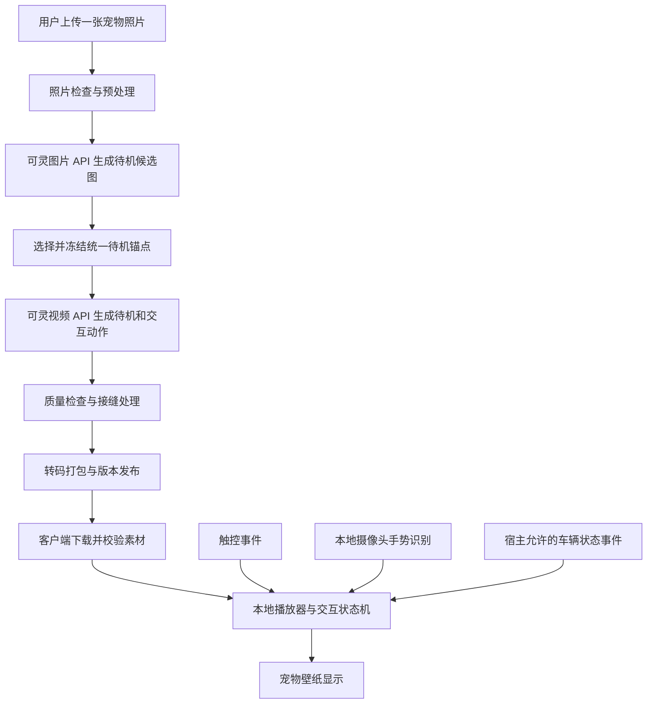
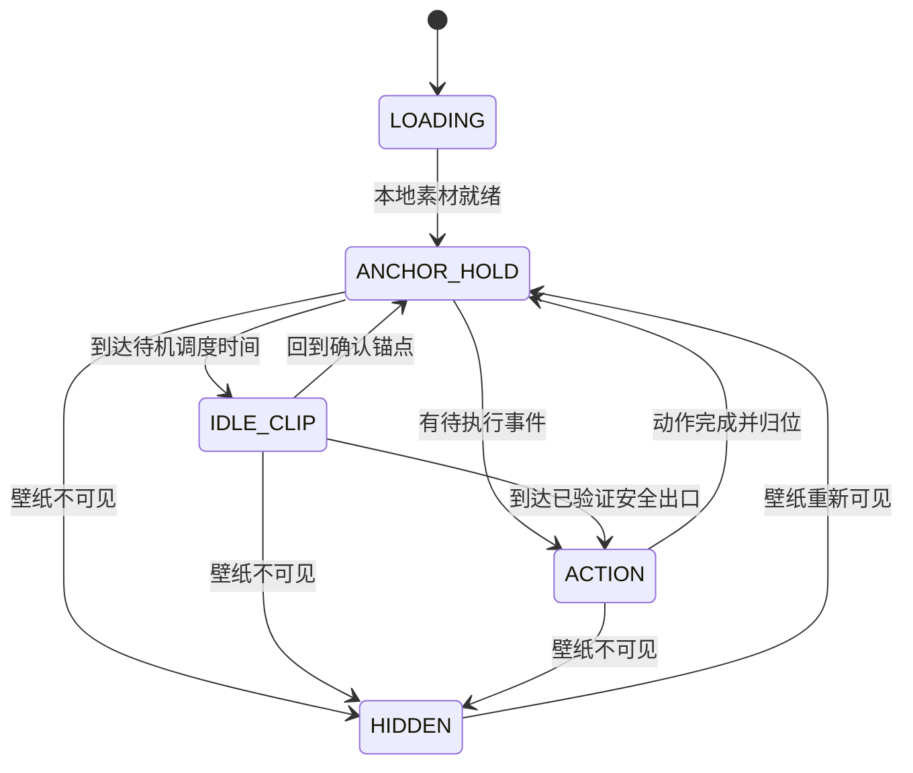

<!-- 文件用途：说明基于可灵图片与视频 API 的宠物交互壁纸产品、生成链路、端侧交互及验证方案，供需求评审与研发实施使用。 -->

# 宠物交互壁纸技术方案

**可灵图片生成与 Kling 4.0 视频生成路线 · V1.0 · 2026-11-06**

| 项目 | 说明 |
| --- | --- |
| 核心输入 | 用户上传的一张猫或狗照片 |
| 核心输出 | 同一宠物、同一场景下的待机与交互动画素材包 |
| 生成服务 | 可灵 Image 3.0 Omni 图片 API、Kling 4.0 视频 API |
| 运行方式 | 服务端提前生成，客户端下载后离线播放，通过事件切换动画 |
| 目标场景 | 车载宠物壁纸，支持触控和摄像头预设手势 |
| 本文状态 | 方案设计与官方文档核对完成；尚未调用付费接口或完成样片、真机验证 |

## 1. 方案结论与需求范围

建议采用“**统一待机锚点图 + 可灵预生成动作库 + 本地交互状态机**”的总体架构。用户上传照片后，先生成并确认一张标准待机图，再以这张图约束所有动作的起点与终点。服务端完成质量检查和视频处理，客户端负责接收触控、手势等事件并播放对应片段。

第一阶段实现固定镜头的整帧视频壁纸，验证宠物外观、循环衔接和交互体验。第二阶段增加宠物抠像、背景分层与视差合成，形成更强的空间感。若目标屏幕需要真正的多视点裸眼立体显示，还需单独对接显示硬件的视图格式与标定能力。

### 1.1 需求依据

本方案结合本次需求、[前期讨论](chatgpt-conversation://6aed3a5f-b56c-83e8-9231-3a62522387e2)，以及项目内[《裸眼3D动态壁纸》演示稿](../../docs/裸眼3D动态壁纸.pptx)第 2～6 页。演示稿提出车内摄像头、挥手/张掌/左右挥动、预制动作反馈和分层空间感，因此本文保留这些能力，并将照片个性化生成接入原有交互链路。

现有[猫咪参考照片](../inputs/粘贴的图像.png)可用于第一轮实验。照片中的脸部和毛色清晰，但没有完整展示四肢。首轮宜保留现有视角，先测试眨眼、歪头等小动作；生成完整坐姿和伸爪时，需要由用户确认模型补全的身体是否可以接受。

### 1.2 首版功能

| 功能 | 首版定义 | 验证重点 |
| --- | --- | --- |
| 照片个性化 | 单只猫或狗，一张照片，生成 2 张待机候选图供选择 | 花纹、脸型、眼睛和体形是否保留 |
| 待机 | 呼吸或一次眨眼，固定镜头 | 自然度、循环接缝 |
| 轻交互 | 歪头或抬头看向用户 | 与待机的连续性 |
| 伸爪交互 | 单只前爪轻抬、收回 | 肢体正确性、近景透视 |
| 休息交互 | 小幅打哈欠后恢复原姿态 | 嘴部、脸型稳定性 |
| 触控入口 | 点击、长按或调试按钮触发对应动作 | 实际动作开始延迟 |
| 隔空入口 | 摄像头识别挥手、张掌，转成同一套动作事件 | 误触发、弱光和识别距离 |
| 离线运行 | 素材下载完成后不依赖生成服务 | 断网、重启、文件校验 |

每只宠物首版交付 **1 张确认待机图、1 段待机视频、3 段交互视频和 1 份素材清单**。优先采用每段 5 秒、720p 的验证规格，效果通过后再评估 1080p。时长与分辨率是实验配置，不代表已完成效果验证。

### 1.3 版本边界

首版交互采用预设事件，例如“张掌触发伸爪”。任意位置跟随手指、连续抚摸时局部变形、自由转身与任意视角观察，需要实时动画或更多方向素材，列入后续版本。

现有演示稿中的“裸眼3D”主要通过前后景、透视、遮挡和边缘延展表达空间感。普通屏幕可先验证这种视觉表现；二维生成视频本身不提供完整三维几何或多视点视图。目标 SoC、Android 版本、屏幕尺寸、显示格式与摄像头接口仍需在工程启动时确认，前期讨论提到的 SA8255P / Android 14 暂作候选条件。

## 2. 可灵模型与 API 选型

### 2.1 选型结果

| 环节 | 首选配置 | 选型理由 |
| --- | --- | --- |
| 照片到待机图 | Kling Image 3.0 Omni，`model_name = kling-v3-omni` | 通过参考图片和提示词统一宠物、场景、姿态 |
| 待机与动作 | Kling 4.0 的 Image-to-Video | 使用同一张图配置首帧、尾帧 |
| 一致性增强实验 | Kling 4.0 的 Omni Reference | 在关键帧之外补充宠物照片或动作参考 |
| 实时交互 | 客户端状态机与本地播放器 | 生成过程与用户现场交互解耦 |

图片接口使用 `POST /v1/images/omni-image`，支持 `kling-v3-omni`；参考图通过 `image_list` 传入。图片模型和视频模型分别选型，产品中的“使用可灵”不意味着两者共享同一个模型版本或请求结构。[官方 Omni 图片接口](https://kling.ai/document-api/apiReference/model/OmniImage)

Kling 4.0 支持首尾帧、多关键帧，以及 3～30 秒的视频生成。当前 API 路线按 720p / 1080p 设计，4K / HDR 不作为本期交付前提。4.0 Flash 当前不支持首尾帧和多关键帧，不能直接替代本方案的闭环动作生成。[官方 API 更新](https://kling.ai/document-api/updates/api?date=2026-02-11)、[官方模型指南](https://kling.ai/quickstart/kling-4-model-user-guide)

### 2.2 主路线与增强路线

**路线 A：同图首尾帧。** 只传入确认待机图和单个动作描述，先验证最低复杂度的链路。全部视频使用同一锚点资产版本，禁止每个动作分别重新生成起始宠物形象。

**路线 B：关键帧加身份参考。** 路线 A 出现花纹、眼睛或脸型漂移时，通过 Omni Reference 同时声明关键帧与宠物参考图，明确原照片只控制身份、锚点控制构图，必要时再加入动作参考视频。路线 B 必须与路线 A 对照实验，不能预先假定增加参考素材就一定提高通过率。

两条路线的 API 分别为 `/image-to-video/kling-4.0` 与 `/omni-video/kling-4.0`。专用图生视频入口只接收关键帧图片；需要额外参考素材时使用 Omni 入口。[官方 Kling 4.0 API 手册](https://kling.ai/document-api/api/usage-guide/kling-4-0)

## 3. 总体架构与产品流程



### 3.1 用户流程

1. 上传照片，选择场景模板，系统提示照片是否适合当前姿态。
2. 查看两张待机候选图，确认“像自己的宠物”后开始生成动作。这里是形象选择步骤，不需要让用户理解 API 或模型参数。
3. 展示“准备形象、生成动作、检查效果、可下载”等真实阶段。进度依据任务完成情况计算，不伪造精确生成百分比或固定完成时间。
4. 全部必需动作通过后，预览、下载并应用壁纸。个别动作失败时，允许替换该动作或发布明确标注的精简素材包。
5. 下载完成后在本地互动；用户更换照片、场景或锚点图时，创建新的素材版本。

如果需要全自动流程，可以由系统初选待机图，但应保留用户预览与重做入口。身份相似度自动评分不足以替代宠物主人的确认。

### 3.2 模块职责

| 模块 | 主要职责 | 输出 |
| --- | --- | --- |
| 上传与预处理 | 修正照片方向、去除无关元数据、检查主体数量与清晰度 | 规范照片、检查结果 |
| 角色资产服务 | 组织参考图、场景模板与身份描述，管理锚点版本 | 确认待机图、资产版本 |
| 任务编排服务 | 创建生成任务、查询状态、控制重试和预算 | 生成记录、可追溯任务状态 |
| 可灵适配层 | 分别封装图片接口与 4.0 视频接口 | 内部统一结果格式 |
| 质量与处理服务 | 抽帧、检查身份和动作、处理接缝、统一编码 | 审核通过的视频、检查报告 |
| 素材存储与分发 | 保存原始结果与成品、文件校验、下载 | 版本化素材包 |
| 端侧交互模块 | 手势/触控转事件、防抖、优先级管理 | 动作请求 |
| 端侧播放模块 | 加载视频、显示锚点、切换、故障恢复 | 壁纸画面 |

## 4. 宠物资产与动画生成

### 4.1 照片准入

首轮限定单只猫或狗。优先接收脸部清晰、眼睛可见、主体无遮挡、身体信息较完整的照片。多人多宠、严重模糊、强遮挡和大面积裁切照片需要重新选择或进入受限模式。

预处理应保留原图副本，修正 EXIF 方向，统一色彩空间，检查图片真实编码与尺寸，移除位置等无关元数据。主体检测和图像质量算法在实现阶段选型，首轮可人工检查，避免先投入完整识别系统。

单张照片缺失的背面花纹和身体结构只能由模型推断。头部照片可优先生成半身构图、眨眼或歪头；完整坐姿、伸爪和大幅转身需要更严格的人工审核，不承诺真实还原照片中不可见的部位。

接口输入采用两条链路都能接受的保守规格：JPEG / PNG、每张不超过 10 MB、宽高均不低于 300 像素，首版统一为 16:9 场景。该规格是项目约束，后续可按具体接口放宽。

### 4.2 统一待机图

先根据原始宠物照片生成待机候选图，确认后冻结。建议固定镜头、正面或小侧面、自然中性姿态，保留动作活动范围，避免爪子伸出后被屏幕裁掉。给图标、时钟等宿主内容留出安全区域。

身份检查关注可见且可核对的特征：毛色分布、额头和胸口花纹、脸型、眼睛颜色、鼻子、耳朵、体形与可见饰品。描述字段可以由人工填写或视觉模型辅助提取，但不得把推断出的特征写成照片事实。

**锚点是所有动作共享的画面基准。** 宠物在画面中的位置、缩放、背景、阴影、光照与调色均随锚点一起锁定。锚点图修改后，依赖该版本的全部动作重新验证，不能直接拼入旧动作。

如果需要“宠物主体图”，优先从确认后的待机图分割得到主体 PNG 和 Mask，使其与待机场景保持像素对齐。原照片抠图可以另外保留为身份参考。首版整帧播放无需把抠图质量设为前置门槛；透明背景及逐帧 Alpha 由独立分割/抠像环节验证。

### 4.3 动作模板

| 动作标识 | 首轮内容 | 约束 | 对应事件 |
| --- | --- | --- | --- |
| `idle` | 自然呼吸或慢眨眼一次 | 幅度小、主体不位移 | 自动待机 |
| `attention` | 轻微歪头后恢复 | 保持脸型与耳朵位置合理 | 点击、挥手唤醒 |
| `paw` | 一只前爪轻抬后放回 | 不增加肢体，爪子不遮住整个脸 | 张掌停留、交互按钮 |
| `yawn` | 小幅打哈欠后恢复 | 不同时伸懒腰、转身 | 长按、低频休息事件 |

每个片段只安排一个核心动作。提示词建议动作在中段完成，末段逐渐回到锚点，预留约 0.3～0.5 秒的平静区域。时间描述是生成引导，精确可切换区域由输出视频分析和人工复核决定。

第一轮不安排跳跃、奔跑、360° 转身或连续多个动作。这些动作增加单照片补全、身份漂移和回到原姿态的难度，可以在小动作通过后逐项扩展。

### 4.4 生成策略

先完成一张确认锚点，再分发四个动作任务。初期每个动作生成两份候选，选择通过者；不合格时只重做对应动作。不同动作可在账户并发额度内并行，单个动作的重试需要依赖质量检查结果顺序推进。

重试优先缩小动作幅度、简化提示、减少遮挡，再对比是否需要 Omni Reference。若多次失败，提供较简单的替代动作。不要无限重试，也不要把失败动画静默标记为完成。

## 5. 循环播放与交互状态机

### 5.1 接缝问题

同一张图作为首尾参考只提供生成约束。输出的边界帧可能仍有像素偏差，即使画面接近，前后运动速度、光照或毛发变化也可能不连续。循环与切换都必须基于最终成品验收。

建议依次处理：检查整个片段，选取自然回到锚点附近的边界，裁去多余停顿；对轻微差异尝试 100～250 毫秒的短过渡；统一色彩和编码后再次检查。宠物轮廓差异较大时，交叉淡化会出现双影，应重做或替换动作。直接覆盖首尾一帧也会产生跳帧，不能作为通用修复方法。

待机片段连续循环 20 次，检查眨眼周期、尾巴方向和亮度突变。动作片段还需验证“待机进入动作”和“动作返回待机”两条接缝。默认不对打哈欠、伸爪视频使用倒放循环，以免动作节奏不自然。

### 5.2 统一中性锚点



`ANCHOR_HOLD` 显示统一待机图，是稳定的切换节点。`IDLE_CLIP` 播放小动作，`ACTION` 播放已选择的交互动作。运行错误时回到待机图，播放器准备好后再恢复。

### 5.3 响应速度与连续性的取舍

如果用户在 5 秒待机视频的任意时刻操作，而播放器只能在片尾切换，最坏等待接近 5 秒。因此“用了相同首尾图”不足以保证即时响应。

首版采用以下规则：

1. 在 `ANCHOR_HOLD` 收到事件时，直接播放已经预加载的动作。
2. 在 `IDLE_CLIP` 中收到事件时，等待下一个审核通过的安全出口。安全出口同时要求姿态接近锚点、运动速度较低，并且切到目标动作没有明显跳变。
3. 如果素材只在片尾可切换，按实际等待时间计入验收。超过延迟目标时，改为“锚点停留 + 低频待机片段”、重做更小幅动作，或升级实时待机动画。
4. 允许立即显示轻量交互提示，但该提示的延迟与宠物开始回应的延迟分别统计。

安全出口密度属于实测结果，不能预先声明每隔几百毫秒一定可以自然切换。即使采用锚点停留模式，用户在待机片段播放期间仍可能等待；若要求任意时刻都快速、自然地改变宠物动作，需要引入实时动画或专门的过渡素材。

### 5.4 事件处理规则

| 情况 | 建议规则 |
| --- | --- |
| 连续点击或连续识别到同一手势 | 防抖与冷却，首轮从 1.5 秒冷却开始调参 |
| 动作播放中再次操作 | 最多保留一个待执行事件，合并重复事件 |
| 多种事件同时出现 | 壁纸隐藏/资源故障优先，其次主动互动，最后自动待机 |
| 事件等待过久 | 丢弃过期事件，避免数秒后补做与当前意图无关的动作 |
| 新动作未准备好 | 保持当前可用画面，禁止显示黑屏或半下载文件 |
| 后台恢复 | 回到锚点，重新开始调度 |

事件队列可先采用 2 秒过期时间，并在体验测试后调整。对需要排队超过该时间的素材，应更换切换策略或素材，而非扩大队列掩盖问题。

### 5.5 端侧播放建议

客户端使用硬件视频解码，预加载当前待机和最可能触发的动作。素材尽量统一尺寸、帧率、色彩与编码，首帧可独立解码。播放器切换期间用同一锚点图覆盖空窗，在目标首帧真正呈现后移除覆盖，避免闪黑。

首版交付建议为 MP4、H.264、SDR、无音轨，24 或 30 fps 经目标设备测试后统一选择。生成接口有声音时在后处理去除音轨；不向 4.0 请求里机械套用旧版的 `sound: off` 字段。

双播放器或双解码器预热可作为优化实验，需要测量解码器并发、内存、发热和切换耗时；不以多开播放器的数量承诺无缝效果。

## 6. 摄像头手势与空间感呈现

### 6.1 手势识别链路

摄像头画面在本地进入手部检测、关键点跟踪与手势判定模块，再转成与触控共用的业务事件。首版从挥手和张掌停留两种手势开始，避免左右挥动与挥手语义混淆。

| 手势/输入 | 业务事件 | 动作 |
| --- | --- | --- |
| 挥手 | `ATTENTION` | 歪头或抬头 |
| 张掌停留 | `PAW` | 抬爪回应 |
| 点击调试入口 | 同名业务事件 | 用于隔离手势识别与播放问题 |
| 左右挥动 | `NEXT_SCENE`，后续扩展 | 切换已生成完整素材的场景 |

设置有效识别区域、识别距离和稳定帧门限。例如首轮以“持续 300～500 毫秒满足条件后触发”作为张掌实验配置，随后按实际帧率、误识别率和延迟调整。挥手采用时间序列的方向变化判定，不能用某一帧的手掌形状代替完整动作。

失去手部跟踪时清理历史窗口；切换用户或重启识别器时重置状态。手势图像默认只在本地处理，生成服务只接收用户选择的宠物照片和场景资产。

### 6.2 Android 与宿主集成

系统动态壁纸可评估 `WallpaperService`：通过 `setTouchEventsEnabled(true)` 开启触控事件，在 `onTouchEvent` 接收，在 `onVisibilityChanged` 管理可见性和播放资源。[Android 官方接口说明](https://developer.android.com/reference/android/service/wallpaper/WallpaperService.Engine)

系统壁纸、车机桌面组件和普通应用预览页应分别联调。桌面是否转发手势、摄像头是否可共享、车辆状态能否读取，取决于目标宿主与权限。先在应用预览页跑通完整链路，再验证实际桌面，避免把预览页结果当成系统壁纸验证结果。

旋钮、车辆状态等输入由宿主映射为业务事件。没有接入权限时保留调试入口，不将模拟事件计作真实车辆接入完成。

### 6.3 两阶段视觉路线

| 阶段 | 素材与实现 | 可实现的效果 | 主要新增工作 |
| --- | --- | --- | --- |
| V1 整帧视频 | 宠物与场景一起生成并播放 | 固定镜头、透视、伸爪靠近镜头、构图上的边界延展 | 视频质量与切换 |
| V2 分层视差 | 静态背景、宠物逐帧 Alpha、必要的前景层 | 轻微视差、遮挡、宠物前景突出 | 毛发抠像、时序稳定、露底修补、GPU 合成 |
| 专项立体显示 | 多视图/左右视图与屏幕 SDK | 取决于具体显示系统的裸眼立体效果 | 视图生成、相机/视点标定、显示适配 |

V2 的宠物 Mask 必须逐帧跟随动作，静态 Mask 会在伸爪时切掉肢体。背景应有干净底图，前景移动后才不会露出原宠物残影。相对深度可用于视差美术调节，不作为真实距离或完整几何重建结果。

整帧视频更换背景时，原阴影、反射和场景都随视频固化。首版按“宠物 × 场景”生成一整套动作，在锚点处过渡切换场景；后续分层版本再支持更灵活的背景替换。

## 7. API 接入设计

本节是经官方文档核对后的接入示例，**尚未使用账户执行联调**。示例 URL 均为占位地址，实施时替换为服务端可访问的实际图片。图片与视频使用各自的请求和查询协议，禁止混合解析。

### 7.1 鉴权与区域

用户提供的链接是鉴权入口，不能单靠该页面确定图片/视频模型版本。本次核对到的官方文档推荐所有模型使用 **API Key**，请求头为 `Authorization: Bearer <API_KEY>`。AK/SK 生成 JWT 的方式标注为仅适用旧版设计标准。[官方鉴权文档](https://kling.ai/document-api/api/get-started/authentication)

API Key 仅保存在服务端环境变量或密钥服务中，客户端调用本项目后端。示例采用文档给出的 `https://api-singapore.klingai.com`；该域名说明适合服务器位于中国境外的用户。实际部署地域与账户应在接入时核对，创建任务和查询任务使用同一区域，不自行推断其他地域域名。[官方快速开始](https://kling.ai/document-api/guides/get-started/quick-start)

### 7.2 图片生成请求

`POST /v1/images/omni-image`

```json
{
  "model_name": "kling-v3-omni",
  "prompt": "以<<<image_1>>>中的宠物为身份参考，保留可见毛色、花纹、脸型、眼睛和耳朵。生成固定镜头的自然待机画面，使用简洁室内背景与柔和稳定光照，主体周围留出动作空间，右上方留白。只有一只宠物，无文字。",
  "image_list": [
    { "image": "https://assets.example.com/pet/source.jpg" }
  ],
  "resolution": "2k",
  "result_type": "single",
  "n": 2,
  "aspect_ratio": "16:9",
  "external_task_id": "pet001-anchor-v1-attempt01"
}
```

本请求以 `image_list` 保留身份参考，生成两张候选。参考图序号引用使用该图片接口的写法，不能直接沿用视频接口的 `@id`。正式提示词应根据照片是否具备全身信息，明确保留原有半身构图或请求补全坐姿。[官方图片请求字段](https://kling.ai/document-api/apiReference/model/OmniImage)

### 7.3 首尾同图的视频请求

`POST /image-to-video/kling-4.0`

```json
{
  "contents": [
    {
      "type": "prompt",
      "text": "@start是首帧，@end是尾帧，两者为同一张待机图。固定镜头，保持宠物身份、毛色花纹、位置、大小、背景和光照。生成5秒连续镜头：0至1秒自然待机，1至2秒缓慢眨眼一次，2至4秒轻微呼吸，4至5秒回到起始姿态并平静停留。动作小且自然，最后画面与@end一致。无字幕，无背景音乐，无对话。"
    },
    {
      "type": "first_frame",
      "id": "start",
      "url": "https://assets.example.com/pet/anchor_v1.png"
    },
    {
      "type": "last_frame",
      "id": "end",
      "url": "https://assets.example.com/pet/anchor_v1.png"
    }
  ],
  "settings": {
    "duration": 5,
    "resolution": "720p"
  }
}
```

专用图生视频入口不传独立的 `aspect_ratio`，先把待机图制作成目标构图。首尾 URL 指向同一冻结资产。上述请求采用 4.0 的 `contents/settings` 协议，不使用旧版 `image/image_tail/model_name` 的视频请求结构。[官方关键帧配置说明](https://kling.ai/document-api/api/usage-guide/kling-4-0)

### 7.4 图片与视频任务结果映射

| 项目 | Omni 图片接口 | Kling 4.0 视频接口 |
| --- | --- | --- |
| 创建结果任务 ID | `data.task_id` | `data.id` |
| 查询入口 | `GET /v1/images/omni-image/{id}` | `GET /tasks?task_ids={id}` |
| 状态字段 | `task_status` | `status` |
| 成功状态 | `succeed` | `succeeded` |
| 结果位置 | `task_result.images[].url` | `outputs[]` 中 `type=video` 的 `url` |
| 查询数据结构 | 单任务响应的 `data` 对象 | `data` 数组，按 `id` 查找对应任务 |

映射依据：[官方图片任务接口](https://kling.ai/document-api/api/image/o1/image-generation)、[官方 4.0 任务查询示例](https://kling.ai/document-api/api/usage-guide/kling-4-0)。任务 ID、元素 ID 在内部都按字符串保存，避免长整数精度丢失。

### 7.5 异步任务、幂等与重试

业务流水线建议为：

`UPLOADED → INPUT_CHECKED → ANCHOR_GENERATING → ANCHOR_REVIEW → VIDEO_GENERATING → QUALITY_CHECK → PACKAGING → READY`

单个子任务独立记录等待、提交、处理中、成功、失败、提交结果待确认、质检不通过和取消等状态。父任务展示业务阶段，供应商成功只代表生成结束，仍需通过下载、质检和打包才能成为可用素材。

每次提交前保存本地任务记录，以宠物资产版本、场景、动作、提示词版本、候选编号和尝试编号组成业务唯一键。`external_task_id` 用于图片任务关联，不将其等同于供应商防重复扣费保证。4.0 任务先由本地记录关联返回 ID，不在未核实的字段位置强行添加同名参数。

| 异常 | 处理原则 |
| --- | --- |
| 已拿到任务 ID，但仍在生成 | 查询原任务，不重复提交 |
| 提交超时，无法确认是否创建 | 标记结果待确认，先对账或查询可追踪记录，阻止盲目重发 |
| 查询网络失败 | 对原 ID 重试查询 |
| 限流或服务端错误 | 按接口说明退避，限制账户总并发 |
| 余额不足或鉴权错误 | 暂停新提交并记录原因 |
| 图片/参数不合规 | 修正输入，不原样循环重试 |
| 生成成功但质量不通过 | 在重做预算内调整提示或替换动作 |

首轮轮询间隔从约 60 秒开始，加入抖动并按实际限流要求调整。超出业务等待时间后进入待处理状态，不假定云端任务已经取消。图片回调可在协议核实后启用，并保留轮询补偿；视频 4.0 先使用已核实的查询协议，不照搬旧接口回调结构。

生成成功后尽快下载至自有存储，再进行文件大小、解码、时长和摘要校验。客户端不长期依赖供应商临时结果 URL。[官方结果获取说明](https://kling.ai/document-api/api/usage-guide/kling-4-0)

## 8. 素材清单与版本管理

### 8.1 素材包内容

```text
pet001_scene01_v1/
  manifest.json          # 素材版本、动作、交互映射、质量信息
  anchor.png             # 统一待机锚点和故障兜底画面
  poster.jpg             # 列表与下载预览图
  clips/
    idle.mp4             # 待机片段
    attention.mp4        # 歪头或抬头片段
    paw.mp4              # 伸爪片段
    yawn.mp4             # 休息片段
```

后端另行保存原图、原始生成结果、提示词、参数、供应商任务信息、成本和质检记录。客户端只下载运行所需的成品。

### 8.2 清单关键字段

| 字段 | 中文说明 |
| --- | --- |
| `schema_version` | 清单协议版本，客户端据此检查兼容性 |
| `pet_id / scene_id / bundle_version` | 宠物、场景和素材包版本，避免跨版本混播 |
| `anchor_asset_hash` | 锚点文件摘要，校验全部动作的共同依据 |
| `canvas / fit_mode / safe_area` | 画布、缩放裁切规则与安全区 |
| `clips[].action_id / path / sha256` | 动作标识、文件位置与完整性摘要 |
| `clips[].duration_ms / fps / width / height` | 从成品实测的视频参数 |
| `clips[].entry_anchor / exit_anchor` | 片段进出所对应的锚点版本 |
| `clips[].safe_exit_windows_ms` | 通过审核的提前退出时间窗口，无验证结果则为空 |
| `clips[].motion_onset_ms` | 片段开始到可见核心动作的实测时间，纳入响应延迟 |
| `hotspots` | 可交互区域，包含原始画布坐标及对应动作 |
| `events / cooldown_ms / event_ttl_ms` | 事件映射、冷却时间与排队有效期 |
| `quality_review / review_version` | 人工和自动检查状态及规则版本 |

热点坐标必须与画布采用相同的缩放、裁切和偏移变换。只使用固定矩形热点时应说明精度范围，后续再增加逐帧轮廓。

客户端将下载写入临时目录，校验完整后原子切换当前版本，保留上一套可用素材用于回退。只允许同一素材包版本内的动作互相切换。

## 9. 质量检查与验收

### 9.1 生成质量

| 检查项 | 自动检查建议 | 人工复核重点 |
| --- | --- | --- |
| 文件有效性 | 可解码、时长、分辨率、帧数、无损坏 | 完整播放是否正常 |
| 身份一致性 | 检测并跟踪主体，比较宠物区域特征与局部外观 | 仍像原照片中的宠物，花纹/眼睛/脸型稳定 |
| 身体结构 | 关键帧抽检，异常检测作辅助 | 多肢、融爪、尾巴分叉、脸部变形 |
| 镜头与场景 | 背景区域光流、亮度波动、主体尺度变化 | 固定镜头，无背景漂移和景别变化 |
| 循环边界 | 对齐后的边界图像差异、短窗口光流变化 | 接缝无突跳、双影和不自然停顿 |
| 动作完成 | 对照动作模板、检查末段是否归位 | 动作清楚且可识别 |
| 跨片切换 | 实测每个允许出口到目标片段的组合 | 待机到动作、动作回待机均自然 |

整图相似度可能被相同背景抬高，身份检查应以宠物区域及脸部、花纹等局部为主。单一视觉向量分数不作为“同一只宠物”的概率，阈值需要用当前猫狗样本校准。首轮采用机器筛查加人工确认，不能以接口返回成功代替质量通过。

### 9.2 首轮验收目标

以下均为**建议验收门槛，尚无实测结果**。

| 类别 | 初始目标与测量方法 |
| --- | --- |
| 身份与动作 | 必需的四个片段均通过人工身份和身体结构检查 |
| 待机循环 | 连续循环 20 次，无可见突跳、闪黑或明显双影 |
| 完整交互 | 每个动作往返待机各 20 次，连续操作不乱序、不无限排队 |
| 即时提示 | 从输入事件到提示显示，P95 不超过 100 毫秒 |
| 宠物回应 | 低等待方案下，输入事件到可见回应的 P95 目标不超过 800 毫秒；同时报告最大值和退出策略 |
| 手势触发 | 对选定区域、距离、光照，记录每类手势至少 50 次的成功率和端到端延迟；初始成功率目标 90% |
| 手势误触发 | 无主动交互时连续观察至少 30 分钟，初始目标不超过 1 次；需另做自然手部活动干扰测试 |
| 端侧稳定 | 目标设备连续运行 30 分钟，无崩溃、明显卡顿，记录内存、温度与掉帧 |
| 离线与生命周期 | 断网、重启、隐藏恢复、素材损坏与更新中断均有可用画面 |

“可见回应”的计时应包含手势稳定判定、安全出口等待、播放器切换和片段内起始停留。触控入口与手势入口分别报告。若手势需要 500 毫秒稳定判定，再等待较长片尾，必须如实显示总延迟。

800 毫秒目标不是首尾帧方案自动具有的能力。如果视频路线达不到，应先调整待机调度、片段起始节奏与动作幅度；仍无法满足时，转向实时待机/过渡方案，或由产品明确接受较慢响应。

### 9.3 样本与实验设计

第一轮先用项目内一张猫照完成链路，再扩展到 10 只宠物，建议猫狗各 5 只，覆盖长毛、短毛、深色、浅色和明显花纹。照片需获得对应使用授权。

| 实验 | 设置 | 回答的问题 |
| --- | --- | --- |
| 单宠物冒烟 | 2 张待机候选，选 1 张；4 动作 × 2 候选 | API 与本地播放链路能否贯通 |
| 扩展样本 | 10 宠物 × 4 动作 × 2 候选 | 通过率是否依赖某一只宠物 |
| A/B 一致性 | 对失败样本比较首尾帧与 Omni 增强 | 参考图是否改善身份稳定性 |
| 切换方式 | 相同素材比较片尾等待、验证出口、锚点停留 | 连续性、延迟和待机活跃度的取舍 |
| 显示规格 | 通过素材再做 720p / 1080p 对照 | 大屏观感收益与成本、解码负载 |

记录每个动作的首轮通过率、有限重做后的通过率、实际消耗、生成耗时 P50/P95 和人工审核时长。总体平均通过率之外，还需报告最差动作和整套交付率。

## 10. 成本、时延与规模估算

### 10.1 计价口径

官方价格页区分 Flagship 与图片资源。Kling 4.0 无输入视频时，720p 为 **1 Unit/秒**、1080p 为 **1.5 Units/秒**。价格页展示的一个 Flagship 资源包为 500 美元 / 3250 Units，页面列出的折后单价约 0.15386 美元/Unit。本文用它作视频成本分摊示例，不将其视为所有账户的实际结算价。[官方视频价格与资源包](https://kling.ai/dev/pricing?packageFilter=flagship-180&scrollTo=video-package)

Image 3.0 Omni 的 1K/2K 图片为 **8 图片 Units/张**；图片标价为 **0.0035 美元/Unit**，即 0.028 美元/张。图片 Unit 单价不能用于 Kling 4.0 视频预算。[官方图片价格](https://kling.ai/dev/model/image)

### 10.2 无输入参考视频时的示例预算

以下按每张待机候选 2K、每个视频 5 秒计算，**未包含额外重做、人工审核、服务端处理、存储、分发、税费和汇率**。视频使用上述资源包折后 Unit 单价，属于消耗分摊，不等于首次开户充值金额。

| 场景 | 图片数 | 视频数 | 视频总秒数 | 720p 视频 Units | 720p 合计 | 1080p 合计 |
| --- | ---: | ---: | ---: | ---: | ---: | ---: |
| 单宠物，每动作仅 1 候选 | 2 | 4 | 20 | 20 | 约 $3.13 | 约 $4.67 |
| 单宠物冒烟，每动作 2 候选 | 2 | 8 | 40 | 40 | 约 $6.21 | 约 $9.29 |
| 10 宠物扩展轮，每动作 2 候选 | 20 | 80 | 400 | 400 | 约 $62.10 | 约 $92.88 |

例如扩展轮 720p：`400 × 0.15386 + 20 × 8 × 0.0035 ≈ 62.10 美元`。扩展轮单独列预算，未默认包含前面的冒烟任务或后续 A/B 实验。首次需购买多少额度、资源有效期和账户可用并发，以实际控制台为准。

加入动作参考视频后，视频计费会纳入输入时长，不再适用上表。按官方页面的当前规则，输入时长不大于输出时长时，以输出时长的两倍计费；输入更长时，以输入加输出时长计费。对应费率也不同，必须重新计算。[官方带视频输入计价](https://kling.ai/dev/pricing?packageFilter=flagship-180&scrollTo=video-package)

### 10.3 重做与预算控制

单动作最多生成 3 次时，若每次独立通过概率为 `q`，理论期望尝试次数为 `1 + (1-q) + (1-q)^2`，该动作最终通过概率为 `1-(1-q)^3`。这是简化模型，实际重复生成可能存在相关性，需用样本实测替换。

整套交付需要所有必需动作通过，预算不能只根据单视频通过率估算。建议对每只宠物设置候选上限、质量重做上限和总花费上限；一旦达到上限，转为简化动作、发布精简包或人工处理。

### 10.4 时间与端侧体积

整套生成耗时由照片检查、图片排队与生成、用户选图、视频排队与生成、质量重做、下载和后处理共同决定。账户并发充足时可并行动作任务，仍应先实测 P50/P95，再制定交付时效。不能把 5 秒视频时长解释成 5 秒生成时间。

端侧体积可按码率估算：四段各 5 秒，在 3～6 Mbps 时约 7.5～15 MB，另加图片与清单。该数值是编码预算，不是可灵原始输出体积；最终以转码后的文件测量为准。优先保存压缩视频，避免为全部片段常驻展开的原始帧。

## 11. 实施阶段与交付条件

现有演示稿提出约一个月的 Demo 目标。以下是四周的建议工作安排，依赖接口额度、端侧权限和素材通过率，不作为未经验证的工期承诺。

| 阶段 | 工作内容 | 阶段交付与继续条件 |
| --- | --- | --- |
| 第 1 周：生成可行性 | 开通账户能力，核对部署区域；完成一张猫照、一个锚点和四类动作实验 | 样片、请求与任务记录、初始成本与质量表；若身份明显漂移，优先调整生成方案 |
| 第 2 周：素材流水线 | 图片选择、异步任务、下载、质检、接缝处理、清单与预算限制 | 可复用素材包和失败恢复流程；扩展 10 宠物实验 |
| 第 3 周：端侧交互 | 本地播放、状态机、预加载、触控调试、两类摄像头手势 | 离线交互 Demo；完成输入到可见动作的延迟测量 |
| 第 4 周：目标设备集成 | 实际桌面与摄像头联调，生命周期、误触发、性能与素材更新 | 演示版本、验收记录、已知限制；分层视差仅在主链路稳定后追加 |

建议按职责覆盖服务端与生成、客户端与集成、手势算法和内容审核/测试。实际投入人力与任务并行度在立项时确定。

### 11.1 关键风险与对应决策

| 风险 | 观察信号 | 决策 |
| --- | --- | --- |
| 待机图不像原宠物 | 用户否定花纹、脸型或体形 | 先重做锚点，暂停生成全部动作 |
| 中间帧身份漂移 | 首尾相近，中段外观变化 | 降低动作幅度，对比 Omni 增强 |
| 同图首尾但无法自然循环 | 光照或运动边界突变 | 重做/替换片段，小差异才尝试后处理 |
| 动作响应太慢 | 等待片尾占主要时延 | 调整待机策略；严格即时需求转实时动画 |
| 背景切换工作量增加 | 每场景都需要重做动作 | 首版限制模板数量，后续分层复用 |
| 车机收不到输入 | 应用预览可用，桌面不可用 | 尽早验证宿主事件转发与摄像头权限 |
| 分层边缘不稳定 | 毛发闪烁、爪子残缺、背景露底 | 独立验证时序抠像，整帧版本保持可交付 |
| 重做成本过高 | 某动作多次不过、整套交付率低 | 设定上限，替换动作或转为模板化路线 |

### 11.2 工程启动时需要确认的事项

- 目标屏幕是普通屏、分层视觉演示，还是需要多视图输入的裸眼立体屏。
- 实际分辨率、宽高比、安全区、终端 SoC、Android 版本及可用硬件解码能力。
- 摄像头接入与共享方式、手势工作距离，以及桌面/壁纸宿主是否转发输入事件。
- 可灵账户部署区域、4.0 开通条件、实际计费方式和单宠物重做预算。
- 照片是否保留选图步骤，以及允许补全身体到什么程度。
- 展示时是否必须始终连续运动，还是接受锚点停留以降低切换等待。

这些事项不影响先进行服务端样片验证。其中显示类型与宿主权限应尽早明确，它们直接决定后续空间效果和交互集成范围。

## 附录 A：首轮动作提示词

以下提示词由本方案编写，可替换视频请求中的 `text`。它们是实验起点，不构成身份、时间或循环效果保证。各动作都使用同一确认待机图作为 `@start` 和 `@end`。

### A.1 通用约束

```text
@start为首帧，@end为尾帧，两张图是同一张确认的宠物待机图。
只有一只宠物。保持参考图中的可见毛色、花纹、眼睛、鼻子、耳朵和身体比例。
固定镜头，保持背景、光照、主体位置和画面大小稳定。
单个连续5秒镜头，动作自然、幅度小。动作完成后恢复原有姿态。
无字幕、无文字、无背景音乐、无对话。
```

### A.2 待机

```text
0至1秒：自然待机，轻微呼吸。
1至2秒：缓慢眨眼一次。
2至4秒：保持原位置，继续轻微呼吸。
4至5秒：回到@end姿态，平静停留。
```

### A.3 歪头回应

```text
宠物从@start姿态开始，很快注意到镜头方向的用户。
0至1秒：眼神朝向镜头，头部开始轻微倾斜。
1至2.5秒：小幅歪头，保持身体坐姿。
2.5至4秒：缓慢回正。
4至5秒：恢复@end姿态并平静停留。
```

### A.4 伸爪回应

```text
保持与参考图相同的宠物和坐姿，只做一次轻柔抬爪。
0至0.5秒：从@start姿态开始抬起一只前爪。
0.5至2.5秒：前爪向镜头轻轻伸出，身体保持原位，爪子不遮住脸部。
2.5至4秒：前爪自然收回并放回原位置。
4至5秒：恢复@end姿态并平静停留。
保持肢体结构和毛色自然，不增加额外爪子。
```

### A.5 打哈欠

```text
从@start姿态开始，宠物原地做一次小幅自然打哈欠。
0至1秒：开始轻微闭眼、张嘴。
1至2.5秒：完成一次自然打哈欠，保持头部轮廓和毛色。
2.5至4秒：闭嘴并恢复原表情。
4至5秒：恢复@end姿态并平静停留。
身体不转身、不移动，不同时伸懒腰。
```

## 附录 B：资料与证据范围

官方资料核对日期：**2026-11-06**。优先使用开发者 API 文档和价格页；创作界面或宣传页出现更高规格时，不直接视为当前账户 API 已开放能力。

本文的模型参数与价格来自各节相邻的官方链接。身份通过率、循环质量、生成时延、手势识别效果及端侧性能均尚未测量。示例请求依据公开文档组织，不能替代账户联调。

项目目录原有演示稿和图片保持原样。本次仅产出方案文档，未安装模型、未购买资源包、未上传宠物照片、未执行付费生成任务。
