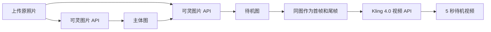

<!-- 文件用途：定义宠物照片生成 Demo 的最小功能、网页流程、可灵调用链和验收方式，供本机开发实施使用。 -->

# 宠物壁纸本机网页 Demo 方案

版本：V0.1 · 日期：2026-11-06 · 状态：本机实现完成，真实账户生成与效果验收待联调

实现入口与使用说明见 [README](../README.md)。已提供原生网页、FastAPI 后端、可灵适配、版本化本地存储、单步重做及安全恢复；离线测试不代表真实生成效果验收。

## 1. Demo 目标

在本机浏览器打开一个页面，上传一张宠物照片，依次获得：

| 输出 | 定义 | 首版规格 |
| --- | --- | --- |
| 目标主体图 | 尽量保留原宠物外观与姿态、去掉复杂原背景、主体居中的参考照片 | 浅色纯背景，PNG/JPEG，2K，不要求透明通道 |
| 待机图 | 同一宠物处于自然中性姿态，放入固定的简洁场景 | 16:9，2K，保留后续小动作空间 |
| 待机视频 | 从待机图出发，轻微呼吸、眨眼，最后回到原姿态 | 5 秒，720p，网页支持循环播放 |

**默认一次上传、一次开始，自动完成三个步骤。** 每步完成后立即显示结果，允许下载和单步重做。

本机运行网页、后端和文件存储，生成工作调用可灵云端 API，因此生成期间需要联网和可用 API 额度。成品保存本地后可再次打开播放。

本期范围为单只猫或狗、一个固定场景、一段待机视频。车机接入、摄像头、手势、多动作切换、分层视差留到后续阶段。

## 2. 页面与操作流程

页面采用一页布局，上方上传，下方依次展示结果。

```text
宠物壁纸 Demo

[选择图片]  原图预览
[开始生成]

当前状态：生成主体图 / 生成待机图 / 生成视频 / 完成 / 失败

原图          目标主体图        待机图          待机视频
[图片]        [图片]            [图片]          [视频播放器]
              [下载][重做]      [下载][重做]    [下载][重做]

失败时：显示失败步骤与简短原因，提供 [重试当前步骤]
```

页面只暴露上传、生成、预览、下载和重做。模型、接口地址、密钥、轮询频率放在后端配置中，首版不做复杂参数面板。

交互规则：

1. 上传后先显示原图，点击“开始生成”再执行付费生成链路。
2. 生成中禁用重复提交，浏览器持续显示当前步骤。
3. 某一步失败时保留之前的成功结果，重试从失败步骤继续。
4. 主体图重做后，旧待机图和视频标记为“待更新”；待机图重做后，旧视频标记为“待更新”。页面提供“继续生成”按钮更新后续结果，避免把不同版本当成一套成品。
5. 浏览器刷新后恢复当前任务及已完成结果，不自动创建新的供应商任务。

## 3. 三步生成链路



### 第一步：原照片生成主体图

使用 Kling Image 3.0 Omni，`model_name = kling-v3-omni`，每次生成 1 张，先请求 2K、1:1。只调整背景与构图，优先保留照片中可见的姿态和身体范围。

主体图是模型生成的角色参考图，是否保留原宠物的花纹、脸型和眼睛，需要在页面对照原图检查。单张半身照片优先生成半身主体图，避免无必要地补全四肢。

建议提示词：

```text
以<<<image_1>>>中的唯一一只宠物为身份参考。
保留可见的脸型、眼睛颜色、鼻子、耳朵、毛色和花纹，保持原有自然姿态。
移除复杂背景，使用均匀浅灰色纯背景，主体居中，完整保留原照片可见的身体范围。
照片质感自然，不添加服装、饰品、其他动物或文字。
```

图片接口为 `POST /v1/images/omni-image`，通过 `image_list` 输入参考图片。[官方图片接口](https://kling.ai/document-api/apiReference/model/OmniImage)

### 第二步：主体图与原照片生成待机图

继续使用 Image 3.0 Omni。原照片作为身份依据，主体图提供整理后的外观和姿态，生成 1 张 16:9、2K 待机图。

同时引用原照片，可以减少连续图片生成过程中外观变化逐步累积。这里是设计措施，改善程度仍需实际样片验证。

首版固定一个“简洁室内、柔和光照”场景。沿用主体图的自然姿态，半身照片可保持半身构图；完整坐姿作为后续选项。

建议提示词：

```text
<<<image_1>>>是原始宠物照片，控制宠物身份、可见毛色花纹、脸型和眼睛。
<<<image_2>>>是主体参考图，参考其姿态和身体范围。
将同一只宠物放入简洁温暖的室内场景，柔和稳定光照，固定镜头。
宠物自然待机、眼睛睁开，保持与主体参考图相近的朝向和姿态。
画面比例16:9，主体周围留出少量活动空间，无其他动物和文字。
```

待机图一旦变化，其视频必须基于新图重新生成。

### 第三步：待机图生成待机视频

使用 `POST /image-to-video/kling-4.0`，将同一张待机图分别声明为 `first_frame`、`last_frame`，配置 `duration = 5`、`resolution = 720p`。该专用入口不另外传 `aspect_ratio`，构图由待机图预先确定。[官方关键帧配置说明](https://kling.ai/document-api/api/usage-guide/kling-4-0)

建议提示词：

```text
@start是首帧，@end是尾帧，两者是同一张待机图。
保持宠物身份、毛色花纹、脸型、位置、大小、背景和光照。
固定镜头，生成5秒连续画面。
0至1秒自然待机，1至2秒缓慢眨眼一次，2至4秒轻微呼吸，
4至5秒回到原姿态并平静停留，末帧与@end一致。
动作自然且幅度很小，无字幕、无背景音乐、无对话。
```

输出先直接在网页循环播放。首尾同图是生成约束，不能保证无缝循环；首版人工检查接缝，不加入自动光流评估、视频抠像或复杂修复流水线。

## 4. 最小技术实现

### 4.1 技术组合

| 部分 | 建议实现 |
| --- | --- |
| 网页 | 原生 HTML、CSS、JavaScript，使用图片预览和 HTML 视频播放器 |
| 本地后端 | Python 3 + FastAPI，同一服务提供页面、上传、状态和成品访问 |
| 可灵调用 | 后端 HTTP 请求与异步状态查询 |
| 任务执行 | 单进程、一次执行一个生成流程，长任务在后台执行 |
| 存储 | 本地目录 + 每个任务一个 JSON 状态文件 |
| 浏览器入口 | 规划为 `http://127.0.0.1:8000`，实现后以实际启动地址为准 |

FastAPI 提供文件上传与静态文件服务，适合这个小规模本机 Demo。[官方上传文档](https://fastapi.tiangolo.com/tutorial/request-files/)、[官方静态文件文档](https://fastapi.tiangolo.com/tutorial/static-files/)

首版使用一个本地服务即可，不引入前端构建链、数据库、Redis、独立任务队列或公网部署。

### 4.2 本地图片如何交给云端

不能把 `127.0.0.1` 图片地址直接交给可灵，云端无法读取用户电脑上的本地服务。

采用以下最短链路：

- **图片生成输入**：后端读取原图和主体图，按图片接口支持的 Base64 方式提交。
- **视频生成输入**：保存可灵返回的待机图结果 URL，将它同时用于视频首尾帧；本地另外下载一份用于展示和留存。
- **网页展示**：全部使用本地保存的成品地址，降低临时结果链接过期对页面的影响。

图片接口已明确支持 Base64 或可访问 URL。[官方输入要求](https://kling.ai/document-api/apiReference/model/OmniImage)

视频请求采用的待机图 URL 是否可由视频服务读取，需要在第一轮联调确认。若重试时供应商链接失效，先尝试重新查询图片任务获取可用链接；仍不可用时再接入临时对象存储，不将公网存储作为第一版必需组件。

### 4.3 本地接口规划

下表接口已实现，另补充 `GET /api/config`、`GET /api/jobs` 和 `POST /api/jobs/{id}/reconcile`，用于就绪状态、历史恢复和提交不明时的人工核对。

| 接口 | 用途 |
| --- | --- |
| `GET /` | 打开 Demo 页面 |
| `POST /api/jobs` | 上传照片并创建三步生成任务，立即返回任务 ID |
| `GET /api/jobs/{id}` | 获取阶段、错误、已完成的图片和视频地址 |
| `POST /api/jobs/{id}/retry` | 指定失败或重做阶段，创建该阶段的新尝试 |
| `POST /api/jobs/{id}/continue` | 从待更新的首个下游阶段继续生成 |
| `GET /api/jobs/{id}/files/{name}` | 预览或下载当前任务的允许文件 |

文件访问只允许当前任务中登记的文件，不能把整个本地目录直接暴露给浏览器。

建议状态为：

`已上传 → 主体图生成中 → 待机图生成中 → 视频生成中 → 完成`

每个阶段独立记录供应商任务 ID、尝试编号、输出文件、输入版本和错误。网页每 3 秒查询本地后端；后端按供应商要求查询远端任务，首轮从约 60 秒一次开始，两者互不绑定。

任务状态写入 JSON 文件，页面刷新可恢复显示。服务重启后，对于已有供应商 ID 的任务继续查询；对于提交结果无法确认的任务，先标记待核对，不自动重复发起可能付费的生成请求。

### 4.4 文件与配置

```text
algorithm-lab/
  app/                     # 本地后端和可灵适配代码
  web/                     # 页面、样式、浏览器脚本
  data/jobs/<任务ID>/
    input.jpg              # 规范化后的原图
    subject-v1.png         # 主体图尝试版本，当前版本由 JSON 指向
    idle-v1.png            # 待机图尝试版本
    video-v1.mp4           # 视频尝试版本
    job.json               # 阶段、版本、任务ID与错误信息
  .env                     # 本地密钥与接口区域配置，不提交 Git
```

文件扩展名以实际编码为准。已有结果重做时保留尝试版本，当前文件只指向选定结果。

API Key 只在本地后端读取，配置可采用 `KLING_API_KEY` 和 `KLING_BASE_URL`。生成过程中，选定照片会由后端提交至可灵。浏览器不保存密钥、不直接请求可灵。

## 5. 开发顺序与验收

按三个小步骤实施：

1. **页面骨架**：上传原图、显示四个预览位、任务状态和文件下载。开发时可用占位素材核对布局，页面明确标注占位状态。
2. **图片链路**：接通主体图、待机图生成，验证原图身份保留与单步重做。
3. **视频链路**：接通同图首尾帧生成、本地保存与循环播放，补齐刷新恢复和失败重试。

最小验收标准：

- 一张单宠物照片可以完成两张图片和一段真实生成视频，三个结果均可下载。
- 原图、主体图和待机图可以并排比较；视频在网页连续循环 10 次，无黑屏或播放故障，并人工记录是否存在接缝突跳。
- 失败时能看到具体阶段，重试不重复生成已经成功的上游步骤。
- 更换待机图后不会把旧视频标记为新图对应的视频。
- 页面刷新可以恢复当前结果，后端重启不会盲目重复创建付费任务。

**每次不重做的完整流程，最低消耗为两张生成图片和一段 5 秒视频。** 先以这一条链路验证身份保持、场景生成和视频衔接，再决定是否增加候选图、交互动作与透明背景输出。生成耗时、费用和效果在首次账户联调时实测记录。
